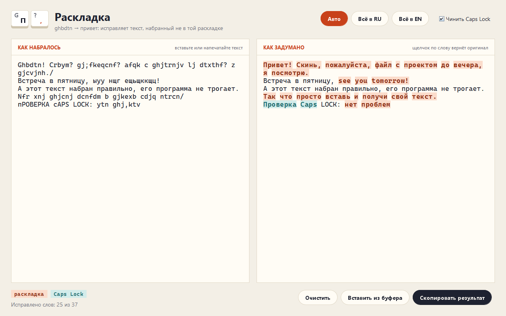

# Раскладка: исправление текста, набранного не в той раскладке

Напечатали полстроки, а там `Ghbdtn? rfr ltkf&`. Раскладка сама понимает, какие слова набраны не на том языке, и возвращает `Привет, как дела?`. Правильный текст, имена и ссылки остаются как были. Работает без интернета, обучение и словари лежат внутри jar.




## Возможности

**Распознавание**
- Автоматически определяет направление для каждого слова: `ghbdtn` → `привет`, `руддщ` → `hello`.
- Исправляет только испорченную часть: в «Встреча в пятницу, ыуу нщг!» поменяется лишь `see you`.
- Короткие слова (`z`, `b`, `c`) решаются по соседям: `b z nj;t` → «и я тоже», а `plan b` остаётся.
- Не трогает ссылки, почту, хэштеги, числа, `snake_case`, аббревиатуры вроде HTML и NASA, имена в русском тексте (iPhone, Lada Vesta).
- Знаки препинания переводятся по клавишам: `?` → `,`, `&` → `?`, `/` → `.`, `;` → `ж`.
- Чинит слова, набранные с нажатым Caps Lock: `пРИВЕТ` → `Привет`.

**Окно**
- Слева то, что набралось, справа то, что задумано; исправление идёт на лету.
- Исправленные слова подсвечены: оранжевым смена раскладки, бирюзовым Caps Lock. При наведении видно оригинал, щелчок возвращает слово как было.
- Режимы «Авто», «Всё в RU», «Всё в EN», переключатель Caps Lock.
- `Ctrl+Shift+V` вставляет из буфера, `Ctrl+Enter` копирует результат.

**Командная строка**
- Текст из аргументов, из stdin или прямо из буфера обмена (`--clip`), чтобы повесить исправление на горячую клавишу.
- `--explain` печатает таблицу с оценками по каждому слову и причиной решения.

## Стек

Java 17, Swing (окно нарисовано вручную, без сторонних тем), Maven, JUnit 5, GitHub Actions. Зависимостей во время выполнения нет.

## Запуск

Нужна Java 17 или новее. Сборка:

```bash
mvn -B package
```

Окно:

```bash
java -jar target/raskladka.jar
```

Командная строка:

```bash
java -jar target/raskladka.jar "Ghbdtn? rfr ltkf&"
echo "руддщ цщкдв" | java -jar target/raskladka.jar -
java -jar target/raskladka.jar --to en "руддщ, цщкдв"
java -jar target/raskladka.jar --explain "Ок, z gjyzk nt,z"
```

Пример `--explain`:

```
слово              вариант                своё    чужое  решение   почему
Ок,                Jr?                   -2.73    -4.31  оставить  по соседям
z                  я                     -5.28    -2.76  исправить по соседям
gjyzk              понял                 -3.77    -1.50  исправить словарь ru
nt,z               тебя                  -4.62    -2.16  исправить словарь ru
```

Исправление по горячей клавише. Скопируйте неудачный текст и запустите:

```bash
java -jar target/raskladka.jar --clip
```

В Windows удобно сделать ярлык на `javaw -jar C:\путь\raskladka.jar --clip` и задать ему сочетание клавиш в свойствах ярлыка. В Linux с X11 буфер живёт, пока жив процесс, поэтому там лучше через xclip:

```bash
xclip -o -selection clipboard | java -jar raskladka.jar - | xclip -selection clipboard
```

В консоли Windows для кириллицы включите UTF-8: `chcp 65001`.

## Как устроено

- `Layout` хранит соответствие клавиш QWERTY и ЙЦУКЕН, включая `[];',.` и знаки на цифрах с Shift. Перевод сохраняет длину текста, поэтому позиции исправлений одинаковы в исходном и итоговом тексте.
- `LanguageModel` — модель символьных триграмм для каждого языка, обученная на встроенных текстах и списке частых слов (`src/main/resources/raskladka`). Оценка слова — средний логарифм вероятности на символ со сглаживанием, нормированный по размеру алфавита, поэтому оценки русской и английской моделей можно сравнивать.
- `Fixer` делит текст на слова и выносит решение в два прохода. Первый проход: словарь своего языка → оставить, словарь чужого → исправить, иначе разница оценок больше порога 0.45 в любую сторону. Короткие и спорные слова помечаются «неясно». Второй проход: такие слова смотрят на ближайших уверенных соседей и голосуют за *задуманный язык*, а не за «исправить или нет». Длинные спорные слова соседи только подталкивают, поэтому имена вроде Tesla не превращаются в «Еуыдф».
- `ui.MainWindow` перезапускает исправление с задержкой 120 мс после ввода, раскрашивает изменения в `JTextPane` и хранит индексы слов, которые пользователь вернул щелчком.
- `--screenshot файл.png` рисует окно с примером без показа на экране; в CI так проверяется отрисовка под Xvfb.

## Тесты

```bash
mvn -B verify
```

Около 50 тестовых случаев на JUnit 5: таблица клавиш и обратимость перевода, модели языков, исправление смешанного текста, короткие слова, ссылки и аббревиатуры, Caps Lock, ручные режимы, смещения изменений и разбор аргументов командной строки. В GitHub Actions после тестов прогоняется jar на примерах и рисуется окно под Xvfb.

## Автор

**whysafe** — fullstack и Unity-разработчик, на фрилансе с 2023 года.

- Сайт: [whysafe.ru](https://whysafe.ru)
- Telegram: [@yawhysafe](https://t.me/yawhysafe)
- Канал: [@whysafe_official](https://t.me/whysafe_official)
- Kwork: [kwork.ru/user/whysafe](https://kwork.ru/user/whysafe)
- Почта: hello@whysafe.ru

Лицензия MIT.
